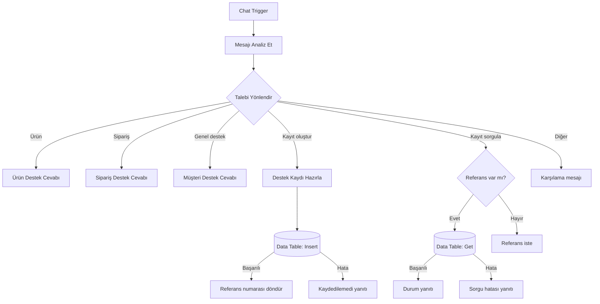

# NovaTech Customer Support Automation 🤖

**Türkçe müşteri hizmetleri otomasyonu | n8n | JavaScript | Data Tables**

NovaTech, hayalî bir teknoloji mağazası için hazırlanmış, genişletilebilir bir **n8n müşteri destek demosudur**. Mesajları anahtar kelime kurallarıyla sınıflandırır; ürün, fiyat, stok, sipariş ve destek sorularına yanıt verir. Açıkça talep edildiğinde destek kaydı açar ve kaydın durumunu n8n Data Tables üzerinden sorgular.

> **Önemli:** Bu proje eğitim/portföy içindir. **WhatsApp bağlantısı veya gerçek bir AI modeli içermez.** Ürünler, fiyatlar, kampanyalar, mağaza ve sipariş verileri kurgusaldır. Gerçek müşteri verileriyle kullanıma hazır değildir.

## ✨ Özellikler

| Alan | Açıklama | Veri kaynağı |
| --- | --- | --- |
| Türkçe otomatik yanıt | Chat Trigger ile mesaj alır, Switch ile yönlendirir | Sabit kurallar |
| Ürün kataloğu | Ürün fiyatı, stok ve ürün listesi | Code node |
| Ürün önerisi / karşılaştırma | Bütçeye göre filtre ve basit fiyat karşılaştırması | Kurgusal katalog |
| Kampanyalar | Örnek indirim hesapları | Kurgusal katalog |
| Sipariş sorgulama | `NT1001`–`NT1003` için örnek durumlar | Kurgusal kayıtlar |
| Teknik destek | Temel sorun giderme, iade/garanti hakkında bilgi | Sabit yanıtlar |
| Destek kaydı açma | `NVT-00001` gibi kayıt referansı üretir | **n8n Data Table** |
| Kayıt durumu sorgulama | Mevcut satırın durumunu getirir | **n8n Data Table** |
| Şikâyet sınıflandırma | Kategori, öncelik ve konu üretir | JavaScript kuralları |

## 🧩 Akış



## 🚀 Kurulum (n8n Cloud / self-hosted)

1. n8n'de **Personal → Data tables → Create Data table** yoluyla `novatech_support_tickets` tablosunu oluştur.
2. Aşağıdaki altı sütunu **String** türünde ekle. Sistem `id`, `createdAt` ve `updatedAt` sütunlarını otomatik oluşturur.

   | Sütun | Tür | Örnek |
   | --- | --- | --- |
   | `message` | String | `Mouse çalışmıyor. Destek talebi oluştur.` |
   | `subject` | String | `Mouse: ürün arızası bildirimi` |
   | `category` | String | `teknik_destek` |
   | `priority` | String | `Orta` |
   | `status` | String | `acik` |
   | `source` | String | `n8n_chat` |

3. n8n'de **New Workflow → üç nokta → Import from File** ile [`workflow/novatech-support.json`](workflow/novatech-support.json) dosyasını yükle.
4. **Destek Kaydini Sakla** ve **Destek Kaydini Getir** düğümlerinde `novatech_support_tickets` tablosunun doğru seçildiğini kontrol et. GitHub'a özgü bir veritabanı paylaşılmadığından, **tabloyu yeni kurulumda yeniden oluşturmak gerekir**.
5. **Destek Kaydini Getir** düğümündeki filtreyi kontrol et: sütun `id`, koşul `Equals`, değer `{{$json.ticketId}}` olmalı.
6. `Chat Trigger` üzerinden **Open chat** aç; aşağıdaki mesajlarla test et. Başlangıçta **Publish gerekmez**.

> Bu JSON, özgün n8n hesabına özgü kimlikler temizlenerek paylaşılmıştır. Kendi n8n hesabında hâlihazırda çalışan botu kullanıyorsan GitHub'a yüklemek için yeniden içe aktarman gerekmez. Düzeltilmiş hata yollarını kendi akışına uygulamak istersen önce bir kopya al.

## 💬 Örnek mesajlar

| Mesaj | Beklenen yanıt |
| --- | --- |
| `Merhaba` | Destek konularını listeleyen karşılama |
| `Mouse fiyatı ne kadar?` | Kurgusal fiyat ve stok |
| `800 TL bütçem var` | Bütçeye göre kurgusal ürün önerisi |
| `Kulaklık ile klavyeyi karşılaştır` | Ürün karşılaştırması |
| `NT1002 siparişim nerede?` | DEMO sipariş durumu |
| `Kargom gecikti. Şikâyet kaydı aç.` | Gerçek Data Table satırı ve `NVT-xxxxx` |
| `NVT-00001 talebimin durumu nedir?` | Data Table'dan kayıt durumu (varsa) |
| `NVT-99999 talebimin durumu nedir?` | Kayıt yok mesajı (yoksa) |

## 🧪 Otomatik testler

GitHub deposunun kök klasöründe **Node.js 18+** ile:

```bash
node tests/run-tests.js
```

Bu testler dış servis gerektirmeden **Code node JavaScript mantığını** doğrular. Gerçek n8n chat, Data Table ekleme/sorgulama ve hata durumları ayrıca n8n hesabında elle test edilmelidir. Ayrıntılar: [`docs/TESTING.md`](docs/TESTING.md).

## 🔒 Güvenlik ve sınırlar

- Müşteri kimliği doğrulanmıyor; destek referansını bilen kişi, sınırlı kayıt alanlarını görebiliyor. **Gerçek müşterilere açma.**
- Veriler kurgusal, ancak gerçek müşteri mesajlarıyla denenirse içerik Data Table'a kaydedilir. Kişisel bilgi kullanma.
- Gerçek sipariş, ödeme, kargo, insan temsilciye yönlendirme veya WhatsApp entegrasyonu **yok**.
- Anahtar kelime eşleştirmesi hatalı sınıflandırmalar yapabilir; güvenlik öncelikleri profesyonel risk değerlendirmesi yerine geçmez.
- İade, garanti ve gönderim metinleri **hukukî taahhüt veya işletme politikası değildir**.
- Dışa aktarılan workflow JSON, **Data Table içindeki satırları içermez**.

Detaylar: [`SECURITY.md`](SECURITY.md).

## 🛠️ Bu GitHub sürümünde yapılan düzeltmeler

- Veri tablosu **Insert / Get** düğümlerindeki hatalar uygun hata yanıtına yönlendirildi.
- `Destek Kaydini Getir` filtresi açıkça **`id = ticketId`** olarak tanımlandı.
- `şikâyet kaydı aç` yazımı da destek talebi açma niyetine eklendi.
- Gerçek bir insan temsilciye bildirim gönderilmiş gibi görünen ifade kaldırıldı.
- Orijinal örnek iş akışının n8n instance/workflow/table kimlikleri GitHub paylaşımı için temizlendi; tabloya **adıyla** bağlanacak şekilde düzenlendi.
- Gerçekte katalogda bulunmayan cihazları öneren genel fiyat mesajı sadeleştirildi.

**Not:** Bu düzeltmelerin otomatik statik kontrolleri ve Code node testleri çalıştırılmıştır; bu düzenlenmiş kopya gerçek bir n8n ortamında uçtan uca çalıştırılmamıştır.

## 🗺️ Yol haritası

- [x] Ürün, sipariş ve müşteri desteği
- [x] Data Tables ile kayıt açma ve sorgulama
- [x] Kategori, konu ve öncelik çıkarma
- [ ] Yetkili personel için destek durumu güncelleme
- [ ] Sahiplik doğrulaması ve yetkilendirme
- [ ] Mesajlardan kişisel verileri ayıklama, saklama süresi
- [ ] Yönetim paneli ve raporlama
- [ ] WhatsApp Business Cloud API entegrasyonu
- [ ] İsteğe bağlı AI Agent ve bilgi bankası

## 📁 Depo yapısı

```text
novatech-customer-support-v2.3/
├── workflow/novatech-support.json   # n8n'e aktarılabilir iş akışı
├── tests/run-tests.js               # çevrimdışı Code node testleri
├── docs/TESTING.md                  # manuel test senaryoları
├── docs/SCHEMA.md                   # Data Table şeması
├── README.md                        # bu dosya
├── README.en.md                     # English overview
├── SECURITY.md                      # kullanım sınırları
├── LICENSE                          # MIT
└── .gitignore
```

## 📚 Belgeler

- [n8n workflow import/export](https://docs.n8n.io/workflows/export-import/)
- [n8n Data Table](https://docs.n8n.io/integrations/builtin/core-nodes/n8n-nodes-base.datatable/)
- [n8n Data Table row operations](https://docs.n8n.io/integrations/builtin/core-nodes/n8n-nodes-base.datatable/rows/)

## Lisans

MIT — bkz. [`LICENSE`](LICENSE). Bu kurgusal demo gerçek NovaTech markası/işletmesiyle ilişkili değildir.
